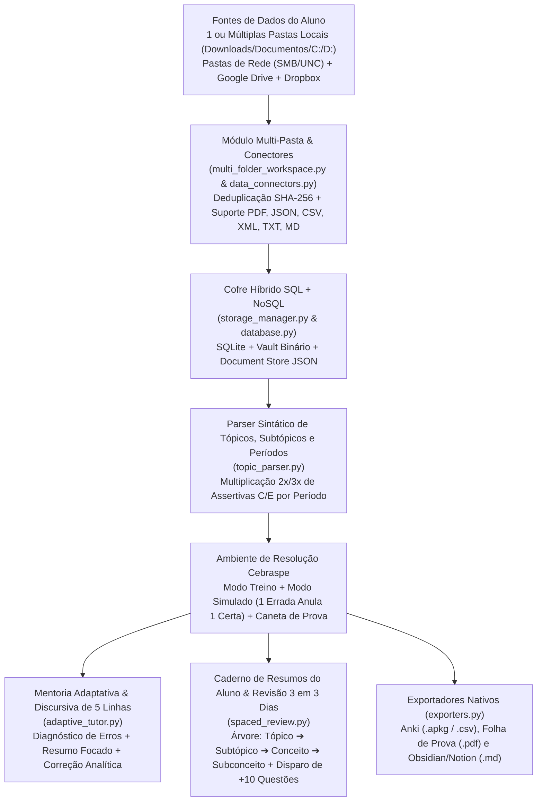

# 🎯 CebraspeLab — Plataforma Inteligente de Estudo Ativo, Múltiplas Pastas, Geração por Períodos e Revisão Espaçada (Estilo Cebraspe / CESPE)

O **CebraspeLab** é uma plataforma completa (*Full-Stack Web App + Executável Único Universal Windows/Linux/macOS + Motor Híbrido SQL/NoSQL + Selecionador de Múltiplas Pastas Locais/Rede/Nuvem + Exportadores Nativos*) projetada para transformar seus materiais de estudo (**PDF, JSON, CSV, XML, TXT e Markdown**) em um ecossistema de **estudo ativo por questões no estilo Certo/Errado da banca Cebraspe (CESPE/UnB)**.

---

## 🚀 Como Iniciar e Usar a Aplicação (Passo a Passo Rápido no Início)

Você **não precisa saber programação** para usar o **CebraspeLab**. Escolha abaixo como abrir o programa no seu computador e siga o roteiro de uso das abas:

### 1️⃣ Como Abrir o Programa (Windows, Linux ou Mac)

| Sistema Operacional | Como Abrir (Forma Mais Fácil) | Alternativa (Pacote Único Universal `.pyz`) |
| :--- | :--- | :--- |
| **🪟 Windows (10 / 11)** | Dê **2 cliques** em **`CebraspeLab-Universal.cmd`**, em **`Iniciar_CebraspeLab.bat`** ou no executável **`dist\CebraspeLab.exe`** | `python dist/CebraspeLab-Universal.pyz` |
| **🐧 Linux (Ubuntu / Debian / Fedora)** | No terminal, na pasta do projeto, rode: `sh ./CebraspeLab-Universal.cmd` | `./dist/CebraspeLab-Universal.pyz` |
| **🍎 macOS (Intel ou Apple Silicon M1–M4)** | No terminal, na pasta do projeto, rode: `sh ./CebraspeLab-Universal.cmd` | `./dist/CebraspeLab-Universal.pyz` |

> 💡 **Assim que você executar:** O sistema inicia o banco de dados local automaticamente e **abre sozinho o seu navegador** no endereço **`http://127.0.0.1:8000`**. Para encerrar quando terminar de estudar, basta fechar a janela do programa.
>
> 🔑 **(Opcional) Configurar Chave Gemini IA:** A aplicação já funciona **100% offline** com o motor sintático de períodos da Cebraspe! Se quiser usar também a IA do Google Gemini, clique no ícone de **Engrenagem (⚙️)** no canto superior direito da tela e cole sua `GEMINI_API_KEY`.

---

### 2️⃣ Roteiro Completo: Como Usar Cada Aba da Plataforma para Estudar

#### 📂 Passo A — Carregar Seus Materiais (Você pode usar a Aba `1` ou a Aba `5`)
* **Pela Aba `1. PDF & Períodos` (Upload Direto de PDF):**
  1. Arraste ou selecione **1 ou mais PDFs de aula/lei seca** (e, opcionalmente, PDFs/JSONs de provas anteriores da Cebraspe).
  2. Clique em **`1. Analisar PDF & Mapear Tópicos`**. O sistema salva seu PDF no **Cofre Binário SQL+NoSQL** e mostra a tabela de recorrência por subtópico.
  3. Clique em **`2. Gerar Assertivas Cebraspe`** (ou nos botões **`Extrair 2x / 3x Questões de Todos os Períodos`** para transformar cada frase do seu PDF em assertivas de Certo e Errado!).
* **Pela Aba `5. Conexões (FS & Nuvem)` (Escolher 1 ou Várias Pastas do Computador ou Nuvem):**
  1. No quadro verde **"Estudo Multi-Pasta"**, escolha quantas pastas quiser:
     - Clique em **`+ Escolher Pasta na Janela do Windows`** para abrir o seletor visual de pastas;
     - Ou clique nos atalhos rápidos (**`+ Downloads`**, **`+ Documentos`**, **`+ Área de Trabalho`**) ou em **`Navegar Pastas na Tela`**.
  2. Clique em **`Escanear Pasta(s) Selecionada(s) & Gerar Caderno Unificado`**.
  3. O sistema lê automaticamente arquivos `.pdf`, `.json`, `.csv`, `.xml`, `.txt` e `.md`, **ignora arquivos repetidos (`SHA-256`)** e monta seu caderno de questões na hora! *(Você também pode conectar pastas de Rede SMB/UNC, Google Drive ou Dropbox).*

#### ✍️ Passo B — Resolver Questões como na Prova (Aba `2. Resolver Bateria`)
1. Escolha entre o **Modo Treino** (gabarito e comentário imediato a cada item) ou **Modo Simulado Cebraspe** (**1 erro anula 1 acerto**, revelando a nota líquida ao finalizar).
2. Use a **Caneta de Prova** (`Riscar Palavra` e `Marca-Texto`) clicando sobre as palavras do enunciado para destacar pegadinhas (`exclusivamente`, `vedado`, `prescinde`, `ex tunc`).
3. Julgue cada item clicando em:
   - **`CERTO (C)`** ou **`ERRADO (E)`**;
   - **`Deixar em Branco (0 pt)`**: quando não tiver segurança e quiser proteger seu escore líquido;
   - **`Acertei com Dúvida (Revisar em 3d)`**: botão ao lado de C/E que envia imediatamente questões em que você chutou ou ficou inseguro direto para o seu **Caderno de Revisão de 3 em 3 Dias**!
4. Exporte sua bateria a qualquer momento nos botões **`Anki (.apkg)`**, **`.csv`**, **`PDF Prova`** ou **`.md`**.

#### 📝 Passo C — Corrigir Pontos Fracos com Resumo + Discursiva (Aba `3. Discursiva 5 Linhas`)
1. Ao abrir a aba **`3. Discursiva 5 Linhas`**, o sistema analisa automaticamente em qual subtópico do PDF você mais errou.
2. Leia o **Resumo Direcionado do Conteúdo** e a **Regra de Ouro Cebraspe** extraída dos períodos do seu PDF.
3. Clique em **`Gerar Mais Questões de Fixação deste Tópico`** ou responda na tela a **Questão Discursiva de até 5 Linhas**. O sistema corrige sua resposta na hora (nota de `0 a 10` + espelho de pontos cobertos) e salva no banco!

#### 🔄 Passo D — Anotar Resumos, Revisar de 3 em 3 Dias e Batalhar Pares Contrastivos (Aba `4. Revisão 3 em 3 Dias`)
1. **Escrever Resumo do Erro:** Clique em qualquer conceito que você errou (ou no botão **`Anotar Resumo deste Erro`** dentro da questão), indique a árvore **`Tópico ➔ Subtópico ➔ Conceito ➔ Subconceito`** e escreva um resumo curto com suas palavras.
2. **Disparo de 3 em 3 Dias (+10 Questões):** Clique em **`Disparar Revisão de 3 em 3 Dias (+10 Questões Agora)`** para gerar uma bateria inédita de 10 itens focada exatamente nos seus resumos vencidos.
3. **Evolução Adaptativa (`3 ➔ 7 ➔ 15 ➔ 30 Dias`):** Após responder a revisão, clique em **`Avaliar ≥85% (3 ➔ 7 ➔ 15 ➔ 30d)`**. Se você acertou $\ge 85\%$ da revisão, o intervalo daquele conceito sobe automaticamente para **7 dias**, depois **15 dias** e **30 dias**! Se ainda houve erro ($< 85\%$), ele permanece no ciclo intensivo de **3 dias**.
4. **Batalha de Pares Contrastivos:** No quadro **"Gerador de Pares Contrastivos"**, clique em **`Gerar Batalha Contrastiva (6 Itens)`** para treinar lado a lado os subconceitos irmãos que a Cebraspe mais troca entre si (*Anulação vs. Revogação*, *Cassação vs. Caducidade*, *Tutela de Urgência vs. Evidência*, *Dispensa vs. Inexigibilidade*).

#### 🛡️ Passo E — Caderno de Erros e Cofre de PDFs (Abas `6` e `7`)
* **Aba `6. Caderno de Erros`:** Veja suas estatísticas de erro por subtópico e por tipo de armadilha da Cebraspe, e clique em **`Gerar Bateria de Reforço dos Meus Erros`**.
* **Aba `7. Cofre PDFs`:** Baixe novamente qualquer PDF original que você já enviou ou reabra qualquer bateria antiga salva no banco.

---

## 🏛️ Arquitetura Completa e Módulos do Projeto



### 1. Módulo de Múltiplas Pastas de Estudo (`backend/multi_folder_workspace.py`)
- **Seleção Simultânea de Múltiplos Diretórios**: Permite cadastrar e sincronizar conjuntos de **1 a N pastas locais ou de rede** simultaneamente (`multi_folder_workspaces`).
- **Navegador Visual + Diálogo Nativo do Sistema Operacional**: Funções `browse_local_folders()`, `list_available_drives_and_quick_folders()` e `pick_folder_native_dialog()` para que usuários leigos selecionem pastas sem digitar caminhos.
- **Deduplicação Inter-Pastas por `SHA-256`**: Durante a varredura de múltiplas pastas (`scan_and_sync_multiple_folders`), arquivos idênticos presentes em pastas diferentes são detectados pelo hash criptográfico e processados uma única vez.
- **Bateria Unificada Multi-Pasta (*Interleaved Practice*)**: Além de gerar baterias por arquivo, consolida automaticamente um **Caderno Unificado Multi-Pasta** combinando questões de todos os diretórios selecionados.

### 2. Conectores de File System Local, Pastas de Rede e Nuvem (`backend/data_connectors.py`)
- Suporta `local_fs` (pastas locais), `network_share` (caminhos de rede SMB/UNC `\\servidor\pasta`), `google_drive` (API REST v3 com cadastro de `API Key` / `OAuth Token` e `Folder ID` pelo usuário), `dropbox` (API v2 com `Access Token` e `App Key`) e `cloud_custom`.
- Parseia nativamente **`.pdf`, `.json`, `.csv`, `.xml`, `.txt` e `.md`**, rastreando cada arquivo em `discovered_study_files` e criando relacionamentos conceituais automáticos.

### 3. Parser de Tópicos, Subtópicos e Multiplicador de Questões por Períodos (`backend/topic_parser.py`)
- Segmenta cada subtópico do PDF em **períodos sintáticos** protegendo abreviações jurídicas e técnicas (`art.`, `inc.`, `§`, `nº`, `CF/88`, `STF`, `STJ`).
- Multiplica cada período em **2x ou 3x assertivas Cebraspe**:
  - **Item CERTO (`C`)**: Paráfrase técnica confirmando o período do PDF.
  - **Item ERRADO (`E`)**: Inversão cirúrgica de modalizadores (*deve ↔ pode*, *vedado ↔ facultado*, *prescinde ↔ imprescinde*, *vinculado ↔ discricionário*, *ex tunc ↔ ex nunc*, *cumulativamente ↔ alternativamente*) ou supressão de exceção (`salvo`, `exceto`).
  - **Item ERRADO (`E` — Situação Hipotética)**: Caso prático com restrição absoluta indevida.

### 4. Armazenamento Híbrido SQL + NoSQL + Cofre Binário (`backend/storage_manager.py` & `backend/database.py`)
- **SQL (`SQLite`)**: Persiste materiais, baterias, histórico de respostas, discursivas de 5 linhas, resumos de erros, relacionamentos conceituais, ciclos de 3 dias, conectores e workspaces de múltiplas pastas.
- **Cofre Binário (`backend/data/pdf_vault/`)**: Guarda os arquivos originais com verificação `SHA-256`.
- **NoSQL Document Store (`backend/data/nosql_document_store.json`)**: Armazena árvores hierárquicas de conhecimento (`pdf_knowledge_trees`), catálogo de arquivos e avaliações discursivas.

### 5. Mentoria Adaptativa & Questão Discursiva de 5 Linhas (`backend/adaptive_tutor.py`)
- Diagnostica o **subtópico e a armadilha onde o aluno mais erra** a partir dos materiais armazenados.
- Apresenta um **Resumo Executivo Direcionado** com a **Regra de Ouro Cebraspe** e os períodos exatos do PDF.
- Gera **mais questões de fixação** daquele ponto fraco e aplica uma **Questão Discursiva de 5 Linhas**, avaliando a resposta digitada pelo aluno com nota de `0 a 10`, checklist de pontos cobertos/ausentes e espelho oficial salvo no banco.

### 6. Resumos de Erros do Aluno, Intervalos Adaptativos (`3 ➔ 7 ➔ 15 ➔ 30d`), Marcador de Dúvida & Pares Contrastivos (`backend/spaced_review.py`)
- Apresenta os conceitos das questões erradas para o aluno classificar na hierarquia:
  $$\text{Tópico} \longrightarrow \text{Subtópico} \longrightarrow \text{Conceito} \longrightarrow \text{Subconceito}$$
- Salva o **resumo escrito pelo próprio aluno** (`student_summary`) e suas anotações (`personal_notes`), agendando a revisão inicial de **3 em 3 dias**.
- Ao disparar a revisão, gera **exatamente +10 questões inéditas** sobre os conceitos anotados nos resumos.
- **Intervalos Espaçados Adaptativos (`3 ➔ 7 ➔ 15 ➔ 30 dias`)**: Ao avaliar a bateria de revisão (`evaluate_spaced_review_cycle_and_adapt_intervals`), se o aluno atingir **$\ge 85\%$ de acerto**, o intervalo daquele conceito avança automaticamente na escada de retenção (`3 ➔ 7 ➔ 15 ➔ 30 dias`). Conceitos com acurácia $< 85\%$ retornam/permanecem no ciclo intensivo de **3 em 3 dias**.
- **Marcador `"Acertei com Dúvida (Revisar em 3d)"`**: Botão ao lado de `CERTO (C)` e `ERRADO (E)` (`queue_doubt_assertion_to_3day_review`) que envia imediatamente acertos inseguros ou chutes para o Caderno de Resumos e Revisão de 3 em 3 Dias.
- **Gerador de Pares Contrastivos ("Batalha de Subconceitos Irmãos")**: Gera baterias curtas (`generate_contrastive_concept_battle_battery`) confrontando lado a lado os subconceitos irmãos que a Cebraspe mais troca entre si (*Anulação vs. Revogação*, *Cassação vs. Caducidade*, *Tutela de Urgência vs. Tutela da Evidência*, *Dispensa vs. Inexigibilidade*, além de pares dinâmicos extraídos da árvore do aluno).

---

## 🌍 Executável Único Universal (Windows, Linux e macOS — Intel `x86_64` & `ARM64` / Apple Silicon)

O projeto conta com **duas camadas de empacotamento** para rodar em qualquer Sistema Operacional e Arquitetura:

### 1. Executável Universal de Arquivo Único Multi-OS (`dist/CebraspeLab-Universal.pyz` + `CebraspeLab-Universal.cmd`)
Como binários compilados em código de máquina puro são presos a um único kernel (`PE .exe` no Windows, `ELF` no Linux, `Mach-O` no macOS), o **CebraspeLab** utiliza um **Pacote Executável Universal PEP 441 (`dist/CebraspeLab-Universal.pyz`, ~165 KB)** aliado ao **Lançador Poliglota de Arquivo Único (`CebraspeLab-Universal.cmd`)**:
- **O que há dentro de `dist/CebraspeLab-Universal.pyz`?** 100% dos módulos do Backend Python + 100% do Frontend React compilado (`frontend/dist`) agrupados em um **único arquivo executável** com cabeçalho `#!/usr/bin/env python3` e auto-bootstrap de dependências (`venv`/`uv`).
- **Como executar o MESMO arquivo em qualquer Sistema Operacional e Arquitetura (`x86_64` ou `ARM64`)**:
  - **No Windows (x64 ou ARM64):** Dê dois cliques em `CebraspeLab-Universal.cmd` ou rode:
    ```powershell
    python dist/CebraspeLab-Universal.pyz
    ```
  - **No Linux (Ubuntu, Debian, Fedora — `x86_64` ou `aarch64`) e macOS (Intel ou Apple Silicon M1/M2/M3/M4):** Execute diretamente o pacote único ou o lançador poliglota:
    ```bash
    ./dist/CebraspeLab-Universal.pyz
    # ou usando o lançador poliglota que funciona em sh/bash/zsh e CMD:
    sh ./CebraspeLab-Universal.cmd
    ```
  - Para regerar o pacote universal após qualquer alteração no código:
    ```powershell
    uv run --directory backend python ../empacotar_universal.py
    ```

### 2. Executável Nativo Standalone para Windows (`dist/CebraspeLab.exe`)
Para computadores Windows sem Python instalado, você também dispõe do binário nativo `dist/CebraspeLab.exe` (gerado via `PyInstaller` pelo script `gerar_executavel.bat`) e do atalho rápido `Iniciar_CebraspeLab.bat`.

### 3. Executando os 47 Testes Unitários Automatizados
Toda a infraestrutura (incluindo a ponte híbrida GitHub Pages <-> PC Local `test_local_bridge_and_pages.py`, intervalos adaptativos `3➔7➔15➔30d`, marcador `"Acertei com Dúvida"`, gerador de pares contrastivos, seletor de múltiplas pastas `test_multi_folder_workspace.py`, conectores `test_data_connectors.py` e pacote executável universal `test_universal_bundle.py`) possui cobertura de testes unitários:
```powershell
uv run --directory backend python -m unittest discover -s tests -v
```

---

## 🌐 GitFlow + GitHub Pages (URL de Alto Nível) Conectado ao Banco Local no PC do Usuário

O projeto foi adaptado para funcionar em **Duplo Modo Híbrido** (`.github/workflows/deploy-github-pages-gitflow.yml` + `backend/local_bridge.py`):

1. **Opção A — Interface no GitHub Pages (URL de Alto Nível) + Banco Local no PC (`127.0.0.1:8000`)**:
   - A interface React é publicada via **GitFlow** (`develop` ➔ `release/*` ➔ `main`) no **GitHub Pages** com `base: '/'` (`frontend/vite.config.ts`) e suporte a `CNAME` customizado (ex: `https://app.cebraspelab.com.br` ou `https://<sua-organizacao>.github.io`), **sem nenhum `/nome-do-repositorio` na URL**.
   - Quando o aluno abre a URL de alto nível no navegador, o cliente (`frontend/src/api.ts`) detecta automaticamente que está em nuvem e conecta todas as requisições ao **Agente Local** rodando no computador do próprio aluno (`http://127.0.0.1:8000/api`) usando o padrão **W3C Private Network Access (CORS-RFC1918 / Chrome PNA)**.
   - **Vantagem**: Você atualiza o visual e recursos da plataforma para todos os alunos fazendo um simples `git push origin main`, enquanto **100% do banco SQL+NoSQL, PDFs, pastas locais (`Downloads`, `Documentos`, `C:\`, `D:\`) e chaves do Google Drive / Dropbox continuam no computador de cada aluno** (custo zero de servidor/banco em nuvem e privacidade total!).
   - Além do seletor nativo do sistema, na Aba `5` o aluno também conta com o botão **`+ Selecionar Pasta pelo Navegador (GitHub Pages / Local)`**, que envia pastas inteiras diretamente pela interface web para o banco local da máquina dele.
2. **Opção B — Execução 100% Local Offline (`http://127.0.0.1:8000`)**:
   - Mesmo sem internet, basta o aluno abrir `CebraspeLab-Universal.cmd` (ou `dist/CebraspeLab.exe`) e usar direto em `http://127.0.0.1:8000`.

### Como configurar a URL de Alto Nível no seu GitHub:
1. Em **Settings ➔ Pages** do repositório no GitHub, em **Build and deployment**, selecione **Source: GitHub Actions**.
2. Para usar seu domínio próprio de alto nível (ex: `app.cebraspelab.com.br`):
   - Crie um registro `CNAME` no DNS do seu domínio apontando `app` para `<seu-usuario>.github.io`;
   - Em **Settings ➔ Secrets and variables ➔ Actions ➔ Variables**, crie a variável `CEBRASPELAB_CUSTOM_DOMAIN` com o valor `app.cebraspelab.com.br` (ou informe no campo `custom_domain` do workflow).

---

## 💰 Como Empacotar e Vender na Hotmart (GitHub Pages + Executável Local)

O projeto já inclui o gerador comercial **`empacotar_hotmart.py`**, que cria automaticamente o arquivo **`dist/Pacote_Hotmart_CebraspeLab.zip`** pronto para ser enviado na área de membros da **Hotmart** (ou Kiwify / Eduzz):

```powershell
uv run --directory backend python ../empacotar_hotmart.py
```

### Passo a Passo para Cadastrar e Vender na Hotmart:
1. **Gerar os Arquivos de Entrega**:
   - Ao rodar `empacotar_hotmart.py` (ou baixar o artefato gerado automaticamente pelo GitHub Actions em `.github/workflows/deploy-github-pages-gitflow.yml`), você terá:
     - **`dist/Pacote_Hotmart_CebraspeLab.zip`**: Contém o executável universal multi-OS (`CebraspeLab-Universal.pyz`), o lançador de 1 clique (`CebraspeLab-Universal.cmd`), o atalho **`Abrir_Interface_Web_CebraspeLab.html`** (que leva o aluno para a sua URL de alto nível do GitHub Pages já conectada ao banco local dele) e o guia **`LEIA_ME_ACESSO_ALUNO.txt`**.
     - **`dist/CebraspeLab.exe`**: Executável nativo standalone para Windows.
2. **Estruturar o Produto na Hotmart (Hotmart Club / Área de Membros)**:
   - **Módulo 1 — Boas-Vindas & Acesso Rápido (Web + Local)**:
     - Disponibilize para download na Aula 1 o arquivo **`Pacote_Hotmart_CebraspeLab.zip`** (e opcionalmente o `CebraspeLab.exe`).
     - Coloque também o botão/link direto para a sua **URL de Alto Nível do GitHub Pages** (ex: `https://app.cebraspelab.com.br`).
   - **Módulo 2 — Como Ativar sua Licença e Conectar suas Pastas de Estudo**:
     - Explique ao comprador que ele pode usar seu **Código de Transação da Hotmart (`HP...`)** clicando no botão **`PC Local Ativo / Licença`** no topo da plataforma para registrar sua licença vitalícia (`POST /api/bridge/activate-license`).
     - Mostre como usar com a chave gratuita do Google Gemini (`GEMINI_API_KEY`) ou 100% offline com o extrator sintático de períodos da Cebraspe.

---

## 📈 Análise do Projeto, Como Otimizar o Estudo por Questões e Recomendações de Evolução

Abaixo está uma análise pedagógica e técnica de como utilizar os módulos já implementados para **maximizar a absorção do conteúdo e o Escore Líquido Cebraspe**, seguida de **melhorias recomendadas para evolução contínua**:

### Como Extrair 100% de Absorção com o Ciclo Fechado do CebraspeLab

1. **Prática Intercalada (*Interleaved Practice*) com Múltiplas Pastas (Aba `5`)**:
   - **Por que funciona**: Estudar apenas uma matéria em bloco (*blocked practice*) cria uma falsa sensação de fluência de curto prazo. Quando você seleciona **2 ou 3 pastas de disciplinas diferentes** (ex: *Direito Constitucional* + *Direito Administrativo* + *Informática*) no **Seletor Multi-Pasta** e gera um **Caderno Unificado**, seu cérebro é forçado a alternar o contexto a cada bloco de itens — exatamente como acontece no dia da prova da Cebraspe.
2. **Leitura Cirúrgica com a Caneta de Prova + Gestão de Risco (Aba `2`)**:
   - Na Cebraspe, **1 erro anula 1 acerto**. Sempre ative a ferramenta **`Riscar Palavra`** ao resolver questões e risque modalizadores (`exclusivamente`, `jamais`, `independe`, `prescinde`, `deverá`, `poderá`).
   - **Regra de Ouro do Branco Estratégico**: Se você não consegue lembrar o fundamento do item mesmo após riscar os modalizadores, clique em **`Deixar em Branco (0 pt)`** e marque a estrela de **Favorita (⭐)**. Nunca chute às cegas no Modo Simulado.
3. **Anotação Rápida com a "Regra das 2 Frases" (Aba `4`)**:
   - Ao errar uma questão, clique no botão **`Anotar Resumo deste Erro (Revisar de 3 em 3 Dias)`** que aparece dentro do próprio gabarito da questão.
   - **Como escrever um resumo de altíssima retenção**: Não copie e cole o texto longo do PDF! Escreva um resumo curto com **suas próprias palavras em 2 frases**:
     - *Frase 1 (A Regra Certa)*: O conceito correto que responde ao item.
     - *Frase 2 (O Gatilho de Alerta)*: O que a Cebraspe tentou inverter (ex: *"Atenção: revogação é ex nunc e só a Administração faz; anulação é ex tunc e o Judiciário também faz"*).
4. **Fechamento de Lacuna com a Discursiva de 5 Linhas (Aba `3`)**:
   - Para o subtópico em que você teve mais erros no dia, vá na aba **`3. Discursiva 5 Linhas`** e redija a resposta de 5 linhas sem consultar o material. A produção textual ativa (*generation effect*) consolida a memória semântica com até **3x mais retenção** do que apenas reler comentários de questões.
5. **Disciplina Inegociável no Disparo de 3 em 3 Dias (+10 Questões) (Aba `4`)**:
   - A curva do esquecimento de Ebbinghaus mostra que cerca de 60% dos detalhes técnicos recém-aprendidos se perdem nas primeiras **72 horas (3 dias)** se não houver evocação ativa.
   - Sempre que o alerta da aba **`4. Revisão 3 em 3 Dias`** acender, dispare imediatamente a bateria de **+10 questões** antes de estudar matérias novas.

### Recursos Avançados de Retenção Já Implementados no Sistema

1. ✅ **Intervalo Espaçado Progressivo (`3 ➔ 7 ➔ 15 ➔ 30 dias`)**:
   - Ajusta o intervalo dinamicamente conforme o desempenho do aluno na bateria de revisão: ao atingir $\ge 85\%$ de acerto, o próximo agendamento sobe de `3 dias` para `7 dias` (depois `15` e `30 dias`); se ficar abaixo de $85\%$, o intervalo retorna para `3 dias`.
2. ✅ **Marcador de Nível de Confiança (`"Acertei com Dúvida (Revisar em 3d)"`)**:
   - Posicionado ao lado dos botões `CERTO (C)` / `ERRADO (E)`, envia automaticamente até mesmo os **acertos duvidosos ou chutes** diretamente para a fila de **Resumos e Revisão de 3 em 3 Dias**.
3. ✅ **Modo "Batalha de Subconceitos Confundíveis" (Gerador de Pares Contrastivos)**:
   - Gera baterias curtas de 6 itens comparando lado a lado pares clássicos que a Cebraspe troca entre si (*Anulação vs. Revogação*, *Cassação vs. Caducidade*, *Tutela de Urgência vs. Tutela da Evidência*, *Inexigibilidade vs. Dispensa*) e pares dinâmicos da árvore `concept_hierarchy_links` do aluno.
4. 💡 **Dica de Prova — Ritmo Ideal no Modo Simulado (*Pacing*)**:
   - Ao utilizar o **Modo Simulado (1 E anula 1 C)** na Aba `2`, mantenha a meta de **45 a 60 segundos por item** de Certo/Errado, reservando de 35 a 40 minutos para redigir sua questão discursiva na Aba `3`.
